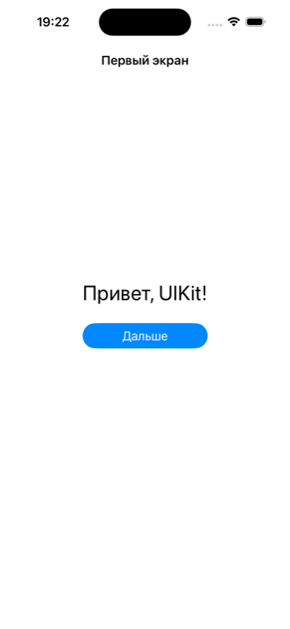
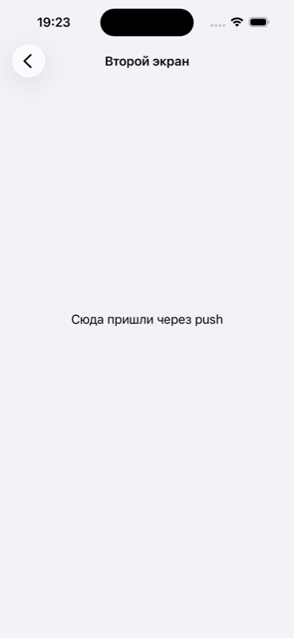

# Глава 0. Карта UIKit — кто от кого наследуется и что это даёт

Эта глава короткая, и её задача одна: чтобы в любой следующей главе ты
понимал, почему код написан именно так. Почему кнопке можно сказать
`addAction`, а лейблу — нет. Почему `UIBarButtonItem` нельзя положить на
экран через `addSubview`. Почему у экрана (`UIViewController`) нет
`frame`, а у его `view` — есть. Почему таблица умеет `contentOffset`,
хотя она «список».

Ответ на все эти «почему» один: **класс умеет то, что умеют его
предки, плюс своё**. Почти весь UIKit стоит на лестнице из четырёх
ступеней:

```
NSObject                  ← любой объект: его можно сравнить и напечатать
 └─ UIResponder           ← умеет получать события (касания, клавиатуру)
     └─ UIView            ← прямоугольник на экране: frame, subviews, слой
         └─ UIControl     ← прямоугольник, который умеет «нажаться»
             └─ UIButton, UISwitch, UISlider, UITextField, …
```

Если знаешь, на какой ступени стоит класс, ты знаешь, что с ним можно
делать, ещё до того, как открыл документацию. Карту ниже мы не
вспоминали по памяти, а распечатали в симуляторе iOS 26.5 — как это
сделать самому, показано в конце главы.

> **Как читать главу.** Не заучивай. Прочитай один раз, запомни четыре
> ступени, таблицу «кто контрол, а кто нет» из раздела 0.4 и
> `SceneDelegate` из раздела 0.7. Остальное
> — справка: главы книги будут ссылаться сюда словами «глава 0,
> раздел 0.N», и тогда вернёшься.

## 0.1 Карта

Строка `A → B` читается «A наследует B».

```
NSObject
├── UIResponder                  получает события
│   ├── UIApplication            приложение, один на процесс
│   ├── UIScene → UIWindowScene  сцена: один экземпляр интерфейса
│   ├── UIViewController         экран (не view!)
│   │   ├── UINavigationController, UITabBarController
│   │   ├── UIPageViewController, UISplitViewController
│   │   ├── UIAlertController, UIActivityViewController
│   │   ├── UIImagePickerController → UINavigationController
│   │   └── UITableViewController, UICollectionViewController
│   └── UIView                   прямоугольник на экране
│       ├── UIWindow             окно — тоже view
│       ├── UILabel, UIImageView, UIStackView
│       ├── UIActivityIndicatorView, UIProgressView, UIPickerView
│       ├── UISearchBar, UINavigationBar, UITabBar, UIToolbar
│       ├── UITableViewCell
│       ├── UICollectionReusableView → UICollectionViewCell
│       ├── UIScrollView
│       │   ├── UITableView
│       │   ├── UICollectionView
│       │   └── UITextView
│       └── UIControl            умеет target-action
│           ├── UIButton, UISwitch, UISlider, UIStepper
│           ├── UISegmentedControl, UIPageControl
│           ├── UIDatePicker, UIColorWell, UIRefreshControl
│           └── UITextField → UISearchTextField
│
├── UIBarItem → UIBarButtonItem, UITabBarItem     описание кнопки панели
├── UINavigationItem                              как экран виден в панели
├── UIGestureRecognizer → UITap…, UIPan…, UIPinch…, UILongPress…
├── UIPresentationController → UISheet…, UIPopover…
├── UIMenuElement → UIAction, UIMenu
├── UIFeedbackGenerator → UIImpact…, UINotification…, UISelection…
├── UICollectionViewLayout → …FlowLayout, …CompositionalLayout
├── NSLayoutConstraint, UILayoutGuide
├── UIColor, UIFont, UIImage, UIBezierPath
├── UITraitCollection, UIScreen, UIDevice, UISceneSession
├── CALayer → CAGradientLayer, CAShapeLayer, CATextLayer
└── CAAnimation → CABasicAnimation, CAKeyframeAnimation, CATransition
```

Карта делится пополам. **Верхняя половина** — всё, что растёт из
`UIResponder`: оно получает события, а ниже `UIView` ещё и видно на
экране. **Нижняя половина** — объекты, которые наследуют `NSObject`
напрямую. Они нужны интерфейсу, но **не view**: у них нет `frame`, их
нельзя `addSubview`, они не ловят касания. Большая часть ошибок «почему
не компилируется» в UIKit — попытка обращаться с нижней половиной как
с верхней.

Что добавляет каждая ступень, одной строкой:

| Ступень | Что даёт | Самое нужное |
|---|---|---|
| `NSObject` | объект можно сравнить (`==`), напечатать, позвать по имени через `#selector` | метод для `#selector` помечай `@objc` |
| `UIResponder` | получает события и передаёт дальше, если не обработал | `becomeFirstResponder()` поднимает клавиатуру |
| `UIView` | прямоугольник: `frame`, `addSubview`, слой `layer`, Auto Layout | `translatesAutoresizingMaskIntoConstraints = false` |
| `UIControl` | «нажатие» и состояния | `addAction(_:for:)`, `isEnabled` |
| конкретный класс | содержимое | `text` у лейбла, `image` у картинки |

Из `NSObject` на практике нужны две вещи. Первая: метод, который
передаёшь через `#selector`, помечай `@objc` — иначе компилятор скажет
«instance method 'tap()' is not exposed to Objective-C». Вторая: класс,
который становится делегатом таблицы или поля, должен наследовать
`NSObject` (`final class Source: NSObject, UITableViewDataSource`), иначе
«should inherit 'NSObject' instead». Экранам и view это не нужно — они
и так наследники `NSObject`.

### Бытовая аналогия

Должностные инструкции в компании. Любой **сотрудник** (`NSObject`) имеет
пропуск, по которому его можно отличить от других. Сотрудник
**приёмной** (`UIResponder`) обязан принимать обращения и передавать
выше, если вопрос не его. Сотрудник **за стойкой в зале** (`UIView`) —
тот же приёмщик, но у него есть рабочее место, которое видно
посетителям. **Кассир** (`UIControl`) — работник за стойкой, который по
нажатию кнопки выдаёт результат.

Кассир умеет всё, что умеют трое выше, плюс своё. А **табличка на
двери** (`UIBarButtonItem`) — не сотрудник: у неё нет рабочего места и
она ничего не принимает. Дверь (`UINavigationBar`) показывает табличку;
хочешь другую надпись — меняешь табличку, а не дверь.

## 0.2 `UIResponder` — кто получает события

**Ответчик** (responder) — объект, который умеет получать касания,
клавиатуру, встряхивание. На этой ступени стоят приложение, сцена,
окно, все view и все экраны, а ещё `AppDelegate` и `SceneDelegate`,
которые шаблон Xcode объявляет наследниками `UIResponder`.

Два факта, которые нужны в работе.

**Цепочка ответчиков.** Событие, которое объект не обработал, идёт
дальше: view → его экран → superview → … → окно → сцена → приложение →
`AppDelegate`. Поэтому в главе 3 окно ловит встряхивание, которое не
обработал ни один экран: до окна оно доходит само. Распечатка цепочки
от кнопки в нашем приложении — в главе 3.

**Первый ответчик.** Для событий без координат — клавиатуры,
встряхивания — цепочка начинается с **первого ответчика**: обычно это
текстовое поле, в котором мигает курсор. `textField.becomeFirstResponder()`
поднимает клавиатуру, `resignFirstResponder()` или `view.endEditing(true)`
— убирает. По умолчанию стать первым ответчиком могут `UITextField` и
`UITextView`; у обычного `UIView` и у экрана `canBecomeFirstResponder`
возвращает `false`.

Чего на этой ступени **нет**: слоёв `CALayer`, распознавателей жестов,
`UIBarButtonItem`. Они участвуют в обработке событий, но сами события
не получают — получает view, к которой они прикреплены.

## 0.3 `UIView` — прямоугольник на экране

Всё, что ты видишь в приложении, — view. Эта ступень даёт четыре вещи:
геометрию, дерево, раскладку и слой. Разберём с числами из симулятора.

### `frame`, `bounds`, `center`

```swift
let box = UIView(frame: CGRect(x: 10, y: 20, width: 100, height: 50))
print(box.frame)    // (10.0, 20.0, 100.0, 50.0)
print(box.bounds)   // (0.0, 0.0, 100.0, 50.0)
print(box.center)   // (60.0, 45.0)
```

- **`frame`** — где view лежит **внутри родителя**: угол в (10, 20), размер
  100 × 50.
- **`bounds`** — тот же прямоугольник **в собственных координатах**:
  начало всегда (0, 0). Когда раскладываешь subviews внутри view, нужен
  именно `bounds`.
- **`center`** — центр `frame`: 10 + 100 / 2 = 60, 20 + 50 / 2 = 45.

Единица — **точка**, не пиксель: у iPhone 16 экран 393 × 852 точки при
масштабе 3 (1179 × 2556 пикселей). Один код даёт одинаковый размер на
экранах разной плотности.

Одно правило про `transform`: после поворота или масштаба `frame`
Apple объявляет **неопределённым** — не читай его и не меняй, двигай
view через `center`, меняй размер через `bounds` (главы 18, 32).

**Упражнение 0.1.** У view `frame = (40, 100, 200, 80)`. Чему равны
`bounds` и `center`? Если присвоить `center = (100, 100)`, каким станет
`frame`? Ответ — в конце главы.

### Дерево: `addSubview`

View вкладываются друг в друга: у каждого одно `superview` и массив
`subviews`. Корень дерева — окно. Последний добавленный subview рисуется
**поверх** предыдущих (мы проверили: из двух одинаковых view касание
достаётся тому, что добавили вторым). Поменять порядок —
`bringSubviewToFront(_:)`, `sendSubviewToBack(_:)`.

`addSubview` принимает только `UIView`. Попробуй положить элемент панели:

```swift
view.addSubview(UIBarButtonItem())
// error: cannot convert value of type 'UIBarButtonItem'
//        to expected argument type 'UIView'
```

Так компилятор напоминает про нижнюю половину карты: у
`UIBarButtonItem` нет `frame`, рисовать нечего.

Перевести точку из координат одной view в координаты другой —
`convert(_:to:)`; `nil` вместо view означает координаты окна (глава 37).

### Раскладка: Auto Layout

Размеры и положение в книге почти всегда задаются **правилами**
(constraints), а не числами: «лейбл на 16 точек правее иконки, по
центру с ней». UIKit решает эти правила и сам ставит `frame`:

```swift
label.translatesAutoresizingMaskIntoConstraints = false
view.addSubview(label)
NSLayoutConstraint.activate([
    label.leadingAnchor.constraint(equalTo: icon.trailingAnchor, constant: 16),
    label.centerYAnchor.constraint(equalTo: icon.centerYAnchor),
])
```

Что здесь важно знать.

- **`translatesAutoresizingMaskIntoConstraints = false`** — первая строка
  для любого view, которое ты расставляешь правилами в коде. По
  умолчанию свойство `true`, и UIKit сам создаёт правила из `frame`; они
  столкнутся с твоими, и в консоли появится «Unable to simultaneously
  satisfy constraints». Ставь его subview, а не корневому `view` экрана.
  Элементам `UIStackView` ставить не нужно — стек делает это сам.
- Правило — объект `NSLayoutConstraint` (не view). Пока не активировано,
  ни на что не влияет.
- **Приоритеты**: 1000 — обязательно, 750 — высокий, 250 — низкий.
  Когда правила спорят, побеждает более важное.
- **Собственный размер.** `UILabel`, `UIButton`, `UISwitch` сами знают,
  сколько места хотят (`intrinsicContentSize`): лейбл «Привет» 17-м
  шрифтом просит 58 × 20 точек. Поэтому лейблу хватает правил на
  позицию, без ширины и высоты. У голого `UIView` такого размера нет.
- **Направляющие** — невидимые прямоугольники с якорями:
  `safeAreaLayoutGuide` (не под вырезом и индикатором Home: на iPhone 16
  это 59 точек сверху и 34 снизу), `layoutMarginsGuide` (поля: 8 точек у
  обычного view, у корневого view экрана — 16 по бокам плюс safe area),
  `keyboardLayoutGuide` (iOS 15, верх клавиатуры; глава 30).

**Когда размеры известны.** Не сразу. UIKit считает раскладку один раз
перед отрисовкой кадра, поэтому в `viewDidLoad` и сразу после
`addSubview` ширина subview равна **нулю**. Окончательные размеры — в
`viewDidLayoutSubviews` экрана или в `layoutSubviews` самого view. Если
`frame` нужен прямо сейчас, например внутри анимации, —
`view.layoutIfNeeded()` (глава 32).

### Слой

У каждого view ровно один слой `CALayer` (`view.layer`) — то, что железо
реально рисует. Скругление, рамка и тень живут в нём:
`layer.cornerRadius`, `layer.borderWidth`, `layer.shadowOpacity`.
Два правила: `layer.masksToBounds` и `view.clipsToBounds` — одно и то же
свойство; тень рисуется **за** краем слоя, поэтому вместе с обрезкой по
краю исчезает (решение — глава 32). Слой не view: касаний не получает,
Auto Layout его не видит, размер задаёшь сам в `layoutSubviews`
(глава 21).

### Кто получает касание

Палец касается экрана — UIKit ищет самый верхний view под ним. Три
условия выключают view из поиска вместе со всеми потомками:
`isHidden`, `alpha < 0.01`, `isUserInteractionEnabled == false`.

Два класса выключены из касаний **по умолчанию**: у `UILabel` и
`UIImageView` `isUserInteractionEnabled == false`. Поэтому жест на лейбле
или картинке не сработает, пока не написать
`label.isUserInteractionEnabled = true` (главы 14, 22, 29).

### Два инициализатора

У `UIView` два инициализатора: `init(frame:)` и `init?(coder:)` — второй
для storyboard и xib, и он `required`. Объявил свой `init` — обязан
написать и его, иначе «'required' initializer 'init(coder:)' must be
provided by subclass of 'UIView'». В книге storyboard для экранов нет,
поэтому везде стоит одна и та же строка:

```swift
    required init?(coder: NSCoder) { fatalError("init(coder:) is not supported") }
```

То же у `UIViewController`.

## 0.4 `UIControl` — view, которое умеет «нажаться»

`UIControl` добавляет к view **target-action**: ты не следишь за
касаниями сам, а говоришь «при таком событии вызови вот это»:

```swift
button.addAction(UIAction { [weak self] _ in self?.save() }, for: .touchUpInside)
```

`addAction` появился в iOS 14; старый способ — `addTarget(self, action:
#selector(didTap), for:)` с `@objc`-методом. События (`UIControl.Event`):

| Событие | Когда | У кого |
|---|---|---|
| `.touchUpInside` | палец поднят внутри — обычный «тап» | `UIButton` |
| `.valueChanged` | значение изменилось | `UISwitch`, `UISlider`, `UIStepper`, `UISegmentedControl`, `UIDatePicker`, `UIPageControl`, `UIRefreshControl` |
| `.editingChanged` | изменился текст | `UITextField` |
| `.primaryActionTriggered` | «основное действие» любого контрола | все; к нему привязан `UIButton(primaryAction:)` |

Плюс состояния: `isEnabled` (выключенный контрол серый и не реагирует),
`isSelected`, `isHighlighted`.

### Кто контрол, а кто нет

Самая практичная таблица главы. Если класс — наследник `UIControl`, у
него есть `addAction`. Если нет — о событии сообщает **делегат**,
уведомление или жест.

| Класс | Ступень | Как узнать о событии |
|---|---|---|
| `UIButton` | `UIControl` | `.touchUpInside` |
| `UISwitch`, `UISlider`, `UIStepper`, `UISegmentedControl`, `UIDatePicker`, `UIPageControl` | `UIControl` | `.valueChanged` |
| `UITextField` | `UIControl` | `.editingChanged` или `UITextFieldDelegate` |
| `UIRefreshControl` | `UIControl` | `.valueChanged` — список потянули |
| `UILabel`, `UIImageView` | `UIView` | не контрол: `UITapGestureRecognizer` + `isUserInteractionEnabled = true` |
| `UISearchBar` | `UIView` | не контрол: `UISearchBarDelegate` |
| `UITextView` | `UIScrollView` | не контрол: `UITextViewDelegate` |
| `UIPickerView` | `UIView` | не контрол: `UIPickerViewDelegate` |
| `UIProgressView`, `UIActivityIndicatorView` | `UIView` | только показывают |
| `UIBarButtonItem`, `UITabBarItem` | `UIBarItem` (не view) | `primaryAction` или `target`/`action` |

Попытка повесить действие на лейбл не компилируется:

```swift
label.addAction(UIAction { _ in }, for: .touchUpInside)
// error: value of type 'UILabel' has no member 'addAction'
```

Обратный случай — `UIRefreshControl`: внешне крутилка над списком, но
по карте контрол, и подписка такая же, как на тумблер (глава 23).

**Упражнение 0.2.** Не глядя в таблицу: у каких из классов есть
`addAction(_:for:)` — `UISlider`, `UISearchBar`, `UIPageControl`,
`UIImageView`, `UIDatePicker`, `UITextView`? Для остальных назови, как
узнать об изменении. Ответ — в конце главы.

## 0.5 `UIScrollView` и его наследники

`UIScrollView` — view, содержимое которого больше него самого и
сдвигается пальцем. На этой ступени стоят **три** класса, которыми ты
будешь пользоваться постоянно:

```
UIScrollView
├── UITableView       список строк
├── UICollectionView  сетка или лента
└── UITextView        многострочный текст
```

Из наследования следует то, что иначе выглядит магией:

- у таблицы и коллекции есть `contentOffset` (на сколько прокручено),
  `contentInset` (поля — ими поднимают низ списка над клавиатурой),
  `refreshControl` («потяни, чтобы обновить»), `keyboardDismissMode` —
  это всё свойства scroll view, а не таблицы;
- делегат таблицы `UITableViewDelegate` наследует `UIScrollViewDelegate`,
  поэтому `scrollViewDidScroll(_:)` можно написать прямо в делегате
  таблицы (глава 21);
- `UITextView` прокручивается, а при `isScrollEnabled = false` растёт по
  тексту (глава 13).

**Ячейки** — обычные view, не контролы: `UITableViewCell → UIView`,
`UICollectionViewCell → UICollectionReusableView → UIView`. Тап по строке
обрабатывает таблица и сообщает делегату через `didSelectRowAt`. Своё
содержимое кладут в **`contentView`** ячейки, а не в саму ячейку —
иначе в режиме редактирования оно останется на месте и перекроет
кнопки (глава 12). Ячейки **переиспользуются**: `register` →
`dequeueReusableCell` → `prepareForReuse` (глава 19). `dataSource` и
`delegate` у таблицы — слабые ссылки: ими должен владеть кто-то ещё,
обычно сам экран.

## 0.6 `UIViewController` — экран, а не view

Самое частое недоразумение: считать view controller «большой view».
По карте `UIViewController → UIResponder`, он стоит **рядом** с
`UIView`, а не под ним. У него нет `frame` и `addSubview`:

```swift
let vc = UIViewController()
vc.addSubview(UIView())
// error: value of type 'UIViewController' has no member 'addSubview'
```

**View controller управляет** одним деревом view: создаёт его,
наполняет, знает, когда оно появилось на экране. Книга называет его
**экраном**, потому что обычно один view controller — один экран.

### `view` создаётся лениво

Свойство `view` пустое, пока к нему не обратились. При первом обращении
UIKit вызывает `loadView()` (создаёт пустой `UIView` размером с экран),
затем один раз `viewDidLoad()`. Отсюда два правила: интерфейс собираем в
`viewDidLoad`, а в инициализаторе `view` **не трогаем** — иначе дерево
создастся раньше времени. Узнать, создан ли view, не создавая его, —
`isViewLoaded`.

### Сколько раз что вызывается

| Метод | Когда | Сколько раз |
|---|---|---|
| `viewDidLoad()` | view создан | один раз |
| `viewWillAppear(_:)` | экран сейчас покажут | каждый показ |
| `viewDidLayoutSubviews()` | размеры посчитаны | много раз |
| `viewDidAppear(_:)` | экран показан | каждый показ |
| `viewWillDisappear(_:)`, `viewDidDisappear(_:)` | экран уходит | каждый уход |

«Каждый показ» значит: вернулся по «назад» — снова `viewWillAppear` и
`viewDidAppear`. Поэтому анимацию в `viewDidAppear` защищают флажком
(глава 1), а подписку из `viewWillAppear` снимают в `viewWillDisappear`.
Модальный лист **не** убирает нижний экран, поэтому его
`viewWillDisappear` не вызывается; `.fullScreen` — убирает и вызывает
(глава 28).

### Контейнеры

Экран может содержать другие экраны — так устроены
`UINavigationController`, `UITabBarController`, `UIPageViewController`.
У них есть `children`, у ребёнка — `parent`. Свой контейнер строится в
три шага: `addChild(child)` → добавить `child.view` в своё дерево →
`child.didMove(toParent: self)`. `addChild` сам view **не** добавляет
(глава 20).

Отсюда же `navigationController`, `tabBarController`, `parent` у любого
экрана: UIKit ищет их вверх по родителям, и у экрана, показанного
модально без обёртки, `navigationController` — `nil`.

### `navigationItem` — чей он

Кнопки в панели навигации задаются **у экрана**, а не у панели:
`navigationItem.title`, `rightBarButtonItem`, `searchController`.
`navigationItem` — объект `UINavigationItem` (не view), панель лишь
показывает его для текущего экрана. Поэтому и кнопка «назад»
настраивается через `backBarButtonItem` **предыдущего** экрана
(глава 26). Так же `tabBarItem` описывает экран во вкладках.

### Модальный показ

`present(_:animated:)` показывает экран поверх, `dismiss(animated:)`
закрывает — вызывать можно у любого из двух, UIKit перешлёт
показывающему. Стиль — `modalPresentationStyle`: по умолчанию
`.automatic`, что с iOS 18 означает `.formSheet` (до iOS 18 —
`.pageSheet`); на iPhone это карточка, которую можно смахнуть вниз.
`.fullScreen` — на весь экран. Показом управляет отдельный объект
`UIPresentationController` (не view); у листа это
`UISheetPresentationController` с высотами-`detents` (глава 28).

Готовые экраны — тоже `UIViewController`: `UIAlertController`,
`UIActivityViewController` («Поделиться»), `UIImagePickerController`.
Их показывают через `present`, а не `addSubview`.

## 0.7 Сцена, окно и первый экран кодом

Этот раздел подробнее остальных, потому что именно здесь начинается
любое приложение на UIKit без storyboard: пока не понятно, кто создаёт
окно и откуда берётся первый экран, всё остальное висит в воздухе.
Разберём цепочку от тапа по иконке до лейбла на экране и соберём
крошечное приложение из трёх файлов. Оно собрано и запущено в
симуляторе iPhone 16 с iOS 26.5 — скриншоты ниже оттуда.

### Три объекта над экраном

```
UIApplication        → UIResponder → NSObject    приложение: один на процесс
UIWindowScene        → UIScene → UIResponder     сцена: один экземпляр интерфейса
UIWindow             → UIView → UIResponder      окно: корневой view
   └── rootViewController.view                   дерево view первого экрана
```

**`UIApplication`** — сам процесс приложения. Он один, доступен как
`UIApplication.shared`, и у него есть делегат — твой `AppDelegate`.
Приложение знает свои сцены (`connectedScenes`), умеет открыть URL и
запросить пуши. Экранов и окон оно само не создаёт.

**`UIScene`** — документация Apple называет её «один экземпляр
интерфейса приложения». Представь iPad, на котором «Заметки» открыты в
двух окнах рядом: это одно приложение (`UIApplication`), но **две
сцены**, у каждой свои окна и свой первый экран. На iPhone сцена одна,
но устройство то же: с iOS 13 UIKit всегда создаёт сцену, даже если она
единственная. `UIScene` — базовый класс; на деле UIKit всегда создаёт
её наследника **`UIWindowScene`** — сцену, которая умеет держать окна.
Документация так и пишет: «обычно UIKit создаёт `UIWindowScene`, а не
`UIScene`». Разница для тебя одна: у `UIWindowScene` есть `windows`,
`screen`, `interfaceOrientation` и инициализатор окна
`UIWindow(windowScene:)`; у голого `UIScene` их нет. Поэтому в делегате
сцена приходит как `UIScene`, и первым делом её приводят к
`UIWindowScene`.

Сцена — наследник `UIResponder`, но **не view**: нарисовать её нельзя,
`frame` у неё нет. Это контейнер для окон и источник событий «стала
активной», «ушла в фон» (глава 5). Сцены не создают руками — их создаёт
система по описанию из `Info.plist`.

**`UIWindow`** — окно, и по карте это **view**, самый верхний в дереве.
Окно держит один корневой экран — `rootViewController` — и само
добавляет его `view` в своё дерево. Всё, что видно на экране, лежит
внутри окна. Окно привязано к сцене: `UIWindow(windowScene:)`
(документация: «создаёт окно и автоматически связывает его с указанной
сценой; окно потом доступно через `windows` сцены»).

Ещё два объекта рядом, оба `NSObject`: **`UISceneSession`** — «карточка»
сцены, которую система хранит, пока сцена существует (идентификатор,
роль, конфигурация), и **`UISceneConfiguration`** — описание, как сцену
создать: класс сцены, класс делегата и, если есть, storyboard.

### Кто кого создаёт при запуске

```
[тап по иконке]
 → iOS запускает процесс и создаёт UIApplication
 → UIApplication создаёт AppDelegate (класс помечен @main)
 → AppDelegate.application(_:didFinishLaunchingWithOptions:)
 → UIKit читает Info.plist → Application Scene Manifest
 → AppDelegate.application(_:configurationForConnecting:options:)
      ← отдаём UISceneConfiguration с именем из Info.plist
 → UIKit создаёт UIWindowScene и UISceneSession
 → UIKit создаёт SceneDelegate (класс из конфигурации)
 → SceneDelegate.scene(_:willConnectTo:options:)
      ← здесь МЫ создаём UIWindow и первый экран
 → сцена активна, окно на экране
```

Два места в этой цепочке — твои: `AppDelegate` отвечает, какую
конфигурацию использовать, `SceneDelegate` строит окно. Всё остальное
делает UIKit. Со storyboard последний шаг тоже делал бы UIKit: ключ
`UISceneStoryboardFile` в конфигурации велит ему загрузить первый экран
из `Main.storyboard`, создать окно и поставить `rootViewController`
самому. Без storyboard этот ключ убирают, и строить окно приходится
руками — ровно четыре строки, их разберём ниже.

### `Info.plist`: Application Scene Manifest

UIKit узнаёт про сцены из словаря `UIApplicationSceneManifest`
(в редакторе Xcode — Application Scene Manifest). В проекте без
storyboard он выглядит так:

```
Application Scene Manifest
├── Enable Multiple Windows: NO           (UIApplicationSupportsMultipleScenes)
└── Scene Configuration                   (UISceneConfigurations)
    └── Application Session Role          (UIWindowSceneSessionRoleApplication)
        └── Item 0
            ├── Configuration Name: Default Configuration
            └── Delegate Class Name: $(PRODUCT_MODULE_NAME).SceneDelegate
```

- **Enable Multiple Windows** — можно ли открыть приложение в нескольких
  окнах на iPad. Шаблон ставит `NO`: одна сцена.
- **Application Session Role** — роль «обычное окно приложения». Есть
  ещё роль внешнего экрана; нам она не нужна.
- **Configuration Name** — имя конфигурации. Его же вернёт `AppDelegate`.
- **Delegate Class Name** — какой класс создать делегатом сцены.
  `$(PRODUCT_MODULE_NAME)` Xcode заменит на имя модуля: Swift-классы
  живут внутри модуля, и полное имя — `МойМодуль.SceneDelegate`.
- Строки **Storyboard Name** (`UISceneStoryboardFile`) здесь **нет** — её
  удаляют (введение, раздел 0.1). Если оставить и удалить сам
  `Main.storyboard`, приложение упадёт при запуске: «Could not find a
  storyboard named 'Main'».

### `AppDelegate` — отвечает на один вопрос

```swift
import UIKit

@main
final class AppDelegate: UIResponder, UIApplicationDelegate {

    func application(_ application: UIApplication,
                     didFinishLaunchingWithOptions launchOptions:
                         [UIApplication.LaunchOptionsKey: Any]?) -> Bool {
        true
    }

    func application(_ application: UIApplication,
                     configurationForConnecting connectingSceneSession: UISceneSession,
                     options: UIScene.ConnectionOptions) -> UISceneConfiguration {
        UISceneConfiguration(name: "Default Configuration",
                             sessionRole: connectingSceneSession.role)
    }
}
```

`@main` — точка входа: компилятор сам напишет функцию `main`, которая
запустит `UIApplication` и назначит этот класс делегатом. Класс
наследует `UIResponder` (последнее звено цепочки ответчиков, раздел 0.2)
и реализует протокол `UIApplicationDelegate`.

`didFinishLaunchingWithOptions` — «процесс запущен». Возвращаем `true`.
Окно здесь **не создают** — это работа сцены.

`configurationForConnecting` — UIKit собирается создать сцену и
спрашивает: «с какой конфигурацией?». Отвечаем именем из `Info.plist` и
той же ролью, что у сессии. UIKit найдёт в манифесте запись с этим
именем и возьмёт из неё класс делегата.

### `SceneDelegate` — четыре строки, которые создают интерфейс

```swift
import UIKit

final class SceneDelegate: UIResponder, UIWindowSceneDelegate {

    var window: UIWindow?

    func scene(_ scene: UIScene,
               willConnectTo session: UISceneSession,
               options connectionOptions: UIScene.ConnectionOptions) {
        guard let windowScene = scene as? UIWindowScene else { return }

        let window = UIWindow(windowScene: windowScene)
        window.rootViewController = UINavigationController(
            rootViewController: HelloViewController())
        window.makeKeyAndVisible()
        self.window = window
    }
}
```

Разберём каждую строку — каждая отвечает за свою типичную ошибку.

`UIWindowSceneDelegate` — протокол делегата **оконной** сцены. Он
наследует `UISceneDelegate` (общие методы любой сцены: подключилась,
активна, в фоне) и добавляет оконные. Документация: «не создавайте
объекты `UIWindowSceneDelegate` сами — укажите имя класса в
конфигурации сцены».

`var window: UIWindow?` — **сильная ссылка на окно**. Это не формальность:
сцена окно не удерживает. Убери эту строку (или присваивание ниже) — и
окно освободится сразу после выхода из метода, а экран останется
чёрным. Мы проверили это в главе 3: без ссылки `windowScene.windows`
пустеет.

`scene(_:willConnectTo:options:)` — UIKit зовёт его, когда сцена
подключается к приложению: при холодном запуске или когда пользователь
открывает новое окно на iPad. Документация: «используйте этот метод,
чтобы отреагировать на добавление сцены и начать загрузку данных,
которые ей нужны». Третий параметр `connectionOptions` хранит, **из-за
чего** сцена открылась: по тапу на уведомление, по ссылке, по Handoff
(глава 41).

`guard let windowScene = scene as? UIWindowScene` — сцена приходит как
базовый `UIScene`; окна умеет только `UIWindowScene`, приводим тип.

`UIWindow(windowScene: windowScene)` — создаём окно **с привязкой к
сцене**. Старый инициализатор `UIWindow(frame:)` для приложения со
сценами не подходит: документация просит создавать окно именно через
`init(windowScene:)`, иначе у него `windowScene == nil` и связь со
сценой придётся налаживать вручную.

`window.rootViewController = …` — первый экран. Здесь он обёрнут в
`UINavigationController`, чтобы была панель навигации и можно было
делать `push`. Окно само добавит `view` этого контроллера в своё дерево
и растянет на весь размер — вручную `addSubview` не нужен.

`window.makeKeyAndVisible()` — показать окно и сделать его **ключевым**
(получающим клавиатуру). Документация: это удобная замена двум
действиям, `isHidden = false` и `makeKey()`.

`self.window = window` — та самая сильная ссылка.

Других методов делегату сцены пока не нужно. Когда понадобятся —
`sceneDidBecomeActive`, `sceneWillResignActive`, `sceneDidEnterBackground`
— порядок их вызовов и что в них делать разобраны в главе 5.

### Первый экран целиком кодом

{width=30%}
{width=30%}

```swift
import UIKit

final class HelloViewController: UIViewController {

    private let titleLabel = UILabel()
    private let nextButton = UIButton(configuration: .filled())

    override func viewDidLoad() {
        super.viewDidLoad()
        title = "Первый экран"
        view.backgroundColor = .systemBackground

        titleLabel.text = "Привет, UIKit!"
        titleLabel.font = .preferredFont(forTextStyle: .title1)
        titleLabel.textAlignment = .center

        nextButton.configuration?.title = "Дальше"
        nextButton.addAction(UIAction { [weak self] _ in
            self?.navigationController?.pushViewController(
                DetailViewController(), animated: true)
        }, for: .touchUpInside)

        let stack = UIStackView(arrangedSubviews: [titleLabel, nextButton])
        stack.axis = .vertical
        stack.spacing = 24
        stack.translatesAutoresizingMaskIntoConstraints = false
        view.addSubview(stack)

        NSLayoutConstraint.activate([
            stack.centerXAnchor.constraint(equalTo: view.centerXAnchor),
            stack.centerYAnchor.constraint(equalTo: view.centerYAnchor),
            stack.leadingAnchor.constraint(
                greaterThanOrEqualTo: view.safeAreaLayoutGuide.leadingAnchor, constant: 16),
        ])
    }
}

final class DetailViewController: UIViewController {
    override func viewDidLoad() {
        super.viewDidLoad()
        title = "Второй экран"
        view.backgroundColor = .systemGroupedBackground
        let label = UILabel()
        label.text = "Сюда пришли через push"
        label.translatesAutoresizingMaskIntoConstraints = false
        view.addSubview(label)
        NSLayoutConstraint.activate([
            label.centerXAnchor.constraint(equalTo: view.centerXAnchor),
            label.centerYAnchor.constraint(equalTo: view.centerYAnchor),
        ])
    }
}
```

Это шаблон каждого экрана книги; в нём собраны все ступени карты.

**Экран — наследник `UIViewController`** (раздел 0.6). Своих
инициализаторов нет, поэтому `HelloViewController()` создаётся без
аргументов, и `init?(coder:)` писать не нужно. Всё строится в
`viewDidLoad`: к этому моменту `view` уже создан UIKit'ом (пустой
`UIView` размером с экран), а раньше трогать его нельзя.

**`title`** — свойство экрана; панель навигации возьмёт его в
`navigationItem` и покажет (раздел 0.6).

**`view.backgroundColor = .systemBackground`** — без этой строки корневой
view прозрачный, и под ним будет чёрное окно. `.systemBackground` —
динамический цвет: белый в светлой теме, чёрный в тёмной.

**Лейбл и кнопка** — ступени `UIView` и `UIControl` (разделы 0.3, 0.4):
у лейбла только содержимое (`text`, `font`), у кнопки — ещё и
`addAction`. `UIButton(configuration: .filled())` — кнопка нового
образца (iOS 15) с синей заливкой; заголовок задаётся через
`configuration?.title`. В замыкании `[weak self]`, потому что кнопка
хранит замыкание, а экран хранит кнопку — без `weak` получился бы цикл.

**`navigationController?.pushViewController`** — экран находит свой
`UINavigationController`, поднимаясь по родителям (раздел 0.6). Он есть,
потому что в `SceneDelegate` мы обернули первый экран в навигационный
контроллер. Без обёртки свойство вернуло бы `nil`, и тап ничего бы не
сделал. Второй экран получает кнопку «назад» сам — её рисует панель.

**`UIStackView`** — складывает лейбл и кнопку в столбик с промежутком 24
точки и сам создаёт правила раскладки для своих элементов. Ему, как
любому subview с правилами, нужна строка
`translatesAutoresizingMaskIntoConstraints = false` (раздел 0.3).

**Три правила Auto Layout**: стек по центру экрана, а его левый край —
не ближе 16 точек к безопасной зоне. Ширину и высоту не задаём — их
дадут `intrinsicContentSize` лейбла и кнопки. Правило с
`greaterThanOrEqualTo` сработает только на узком экране или с крупным
шрифтом: тогда стек не вылезет за край, а лейбл перенесёт текст.

Второй экран — тот же шаблон в минимальной форме: заголовок, фон, один
лейбл по центру.

### Как из любого view добраться до окна, сцены и экрана устройства

В `viewDidAppear` второго экрана мы напечатали, что видно «снизу
вверх»:

```swift
print(view.window.map { NSStringFromClass(type(of: $0)) } ?? "nil",
      view.window?.windowScene.map { NSStringFromClass(type(of: $0)) } ?? "nil",
      view.window?.windowScene?.screen.bounds ?? .zero,
      view.window?.windowScene?.session.configuration.name ?? "nil")
```

Вывод в симуляторе iPhone 16:

```
UIWindow UIWindowScene (0.0, 0.0, 393.0, 852.0) Default Configuration
```

То есть путь такой: `view.window` → `windowScene` → `screen`
или `session`. Это и есть замена устаревшему `UIScreen.main`: размер
экрана берут у сцены, в которой живёт view. Два предупреждения:
`view.window` равен `nil`, пока view не в окне — в `viewDidLoad` мы
получили `nil` (тот же вывод до перестановки печати в `viewDidAppear`);
и у окна, созданного без сцены, `windowScene` тоже `nil`.

### Если вместо экрана — чёрный

Четыре причины, по порядку проверки:

1. В `Info.plist` остался **Storyboard Name** или в Build Settings —
   `UIMainStoryboardFile`, а самого storyboard нет: приложение падает при
   запуске с «Could not find a storyboard named 'Main'».
2. Нет `self.window = window` — окно освободилось.
3. Нет `window.makeKeyAndVisible()` — окно создано, но скрыто.
4. В **Delegate Class Name** опечатка или нет `$(PRODUCT_MODULE_NAME).` —
   UIKit не найдёт класс делегата, `willConnectTo` не вызовется. Когда
   конфигурация одна, имя в `configurationForConnecting` может даже не
   совпадать с манифестом — UIKit возьмёт единственную (проверено в
   главе 5), а вот класс делегата должен быть найден.

И одна причина не чёрного, а **прозрачного** экрана: забытый
`view.backgroundColor` у корневого view.

## 0.8 Что не view

Нижняя половина карты — объекты без `frame`. Их не кладут на экран,
они не ловят касания. Как с ними работать:

| Класс | Что это | Как с ним работать |
|---|---|---|
| `CALayer` и наследники | то, что рисует железо | `view.layer.addSublayer`, `frame` задаёшь в `layoutSubviews` |
| `CABasicAnimation`, `CAKeyframeAnimation` | описание анимации слоя | `layer.add(_:forKey:)`; значение свойства меняй отдельно |
| `UIGestureRecognizer` и наследники | распознаватель жеста | `view.addGestureRecognizer`; один жест — одна view |
| `UIBarButtonItem`, `UITabBarItem` | описание кнопки для панели | `navigationItem.rightBarButtonItem = …` |
| `UINavigationItem` | как экран виден в панели | `vc.navigationItem.title = …` |
| `UIAction`, `UIMenu` | действие или меню | `addAction`, `button.menu` |
| `UIPresentationController` | ведёт модальный показ | `vc.sheetPresentationController?.detents` |
| `UIFeedbackGenerator` | хаптика | `prepare()`, `impactOccurred()` (глава 33) |
| `UICollectionViewLayout` | раскладка коллекции | передаётся в `UICollectionView(frame:collectionViewLayout:)` |
| `NSLayoutConstraint`, `UILayoutGuide` | правило раскладки, направляющая | `activate`, `isActive`, `constant` |
| `UIColor`, `UIFont`, `UIImage` | цвет, шрифт, картинка | значения; `UIColor` может быть динамическим |

Три пары, которые путают чаще всего.

**`UIBarButtonItem` и `UIButton`.** Кнопка — view. Элемент панели —
**описание** кнопки: заголовок, картинка, действие. Рисует его панель.
Нужен свой view в панели — `UIBarButtonItem(customView:)`.

**`CALayer` и `UIView`.** Слой дешевле view и умеет градиент, тень,
фигуру по контуру, но не знает про Auto Layout и касания. Его `frame`
выставляют руками в `layoutSubviews` (глава 21).

**`UIGestureRecognizer` и касания.** Распознаватель прикрепляют к одной
view, и он сообщает о жесте через `addTarget` или `UIAction`, как
контрол. По умолчанию он отменяет касание для самой view
(`cancelsTouchesInView`), поэтому на одной view редко совмещают жесты и
`touchesBegan` (глава 29).

Правило большого пальца: **нет `frame` — не view**. Нужно показать —
найди view, которая это отобразит: панель для `UIBarButtonItem`, view для
`CALayer`, `UIImageView` для `UIImage`.

## 0.9 Делегат и источник данных

Наследование — первый скелет UIKit, **протоколы** — второй. Два
протокола встречаются на каждом шагу.

**Делегат** (delegate) — объект, которому класс UIKit сообщает о
событиях и задаёт вопросы: «тапнули строку», «какой высоты строка?».
**Источник данных** (data source) — объект, у которого класс запрашивает
содержимое: «сколько строк?», «дай ячейку для строки 5». Таблица не
хранит твоих данных и не знает твоей логики — она только рисует и
спрашивает. Поэтому один `UITableView` годится и для списка дел, и для
чата.

Три практических правила:

- делегат — всегда **слабая** ссылка, чтобы экран и таблица не держали
  друг друга вечно. Значит, делегатом должен владеть кто-то ещё; обычно
  это сам экран — проблем нет. Свой протокол для `weak var delegate`
  объявляй с `: AnyObject`;
- класс-делегат наследует `NSObject` (раздел 0.1);
- большинство методов делегата **необязательны**: реализуешь три из
  тридцати, остальное UIKit делает по умолчанию.

## 0.10 Проверь сам

Карту не нужно принимать на веру. Функция ниже спрашивает у рантайма
родителя класса, потом родителя родителя — до корня:

```swift
import UIKit

/// «Родословная» класса: сам класс → родитель → … → NSObject.
func superclassChain(of cls: AnyClass) -> String {
    var names = [NSStringFromClass(cls)]
    var current: AnyClass? = class_getSuperclass(cls)
    while let next = current {
        names.append(NSStringFromClass(next))
        current = class_getSuperclass(next)
    }
    return names.joined(separator: " → ")
}
```

`class_getSuperclass` — «дай родителя класса»; у `NSObject` родителя нет,
вернётся `nil`, и цикл закончится. Вызови из `viewDidLoad` любого экрана
книги:

```swift
let classes: [AnyClass] = [UITableView.self, UIBarButtonItem.self, UIViewController.self]
for cls in classes {
    print(superclassChain(of: cls))
}
```

В симуляторе iOS 26.5 мы получили:

```
UITableView → UIScrollView → UIView → UIResponder → NSObject
UIBarButtonItem → UIBarItem → NSObject
UIViewController → UIResponder → NSObject
```

Тем же способом снята вся карта из 0.1 и все числа этой главы:
`print(UILabel().isUserInteractionEnabled)`, `print(UIView().frame)`.
Сомневаешься в утверждении про UIKit — напечатай и посмотри. Это
надёжнее любой статьи, включая эту главу.

**Упражнение 0.3.** Распечатай цепочки для `UISearchBar`, `UITextView`,
`UIImagePickerController` и `UIAlertAction`. Для каждого ответь: можно ли
его `addSubview`, есть ли у него `addAction(_:for:)`, как он попадает на
экран. Ответ — в конце главы.

## Ответы к упражнениям

**0.1.** `bounds` = (0, 0, 200, 80): начало в своих координатах всегда
(0, 0), размер тот же. `center` = (40 + 100, 100 + 40) = (140, 140).
После `center = (100, 100)` размер не меняется, а угол сдвигается так,
чтобы центр оказался в (100, 100): `frame` = (0, 60, 200, 80).
Проверь: создай view с таким `frame`, присвой `center` и напечатай
`frame`.

**0.2.** `addAction(_:for:)` есть у `UISlider`, `UIPageControl` и
`UIDatePicker` — все три контролы, событие `.valueChanged`. Нет у
`UISearchBar` (`UISearchBarDelegate.searchBar(_:textDidChange:)`),
`UIImageView` (`UITapGestureRecognizer` + `isUserInteractionEnabled = true`)
и `UITextView` (`UITextViewDelegate.textViewDidChange(_:)`).

**0.3.** В симуляторе iOS 26.5:

```
UISearchBar → UIView → UIResponder → NSObject
UITextView → UIScrollView → UIView → UIResponder → NSObject
UIImagePickerController → UINavigationController → UIViewController
                        → UIResponder → NSObject
UIAlertAction → NSObject
```

`UISearchBar` — view: `addSubview` можно, `addAction` нет, на экран
попадает как subview или через `navigationItem.searchController`.
`UITextView` — view и scroll view: `addSubview` можно, `addAction` нет,
события через делегат. `UIImagePickerController` — экран, причём целый
навигационный стек: ни `addSubview`, ни `addAction`, на экран — через
`present`. `UIAlertAction` — ни view, ни экран, а описание кнопки алерта;
его рисует `UIAlertController` после `alert.addAction(_:)`.

## Что мы выучили

- Почти весь UIKit стоит на лестнице `NSObject → UIResponder → UIView →
  UIControl → конкретный класс`; класс умеет то, что умеют предки, плюс
  своё.
- Из `NSObject` на практике: `@objc` для `#selector`, `NSObject` в
  предках у класса-делегата.
- `UIResponder` получает события и передаёт по цепочке до окна и
  `AppDelegate`; первый ответчик — поле с курсором,
  `becomeFirstResponder()` поднимает клавиатуру.
- `UIView`: `frame` в координатах родителя, `bounds` в своих; при
  `transform` `frame` не определён. Для правил раскладки —
  `translatesAutoresizingMaskIntoConstraints = false`; размеры subviews
  известны не в `viewDidLoad`, а в `viewDidLayoutSubviews`. У `UILabel` и
  `UIImageView` касания выключены по умолчанию.
- `UIControl` даёт `addAction(_:for:)` и события `.touchUpInside`,
  `.valueChanged`, `.editingChanged`. У `UILabel`, `UISearchBar`,
  `UITextView` этого нет — там жесты и делегаты.
- `UITableView`, `UICollectionView`, `UITextView` — scroll view: у них есть
  `contentOffset`, `contentInset`, `refreshControl`. Ячейки — view, своё
  кладём в `contentView`.
- `UIViewController` — не view: нет `frame` и `addSubview`; `view`
  создаётся лениво, `viewDidLoad` один раз, `viewWillAppear` — каждый
  показ; `navigationItem` принадлежит экрану; `.automatic` — это
  `.formSheet` с iOS 18.
- Запуск без storyboard: `Info.plist` → `AppDelegate` отдаёт конфигурацию →
  UIKit создаёт `UIWindowScene` и `SceneDelegate` → в `willConnectTo` мы
  создаём `UIWindow(windowScene:)`, ставим `rootViewController`, зовём
  `makeKeyAndVisible()` и храним окно в `self.window`.
- `UIWindow` — view (можно `addSubview`), сцена и приложение — ответчики,
  но не view; до них из любого view: `view.window?.windowScene`.
- Слои, жесты, `UIBarButtonItem`, `UINavigationItem`, `UIAction`, цвета,
  constraints — без `frame`: их нельзя `addSubview`, нужно найти view,
  которая их покажет.
- Делегат сообщает о событиях, источник данных отдаёт содержимое; обе
  ссылки слабые.
- Любое утверждение про UIKit проверяется печатью: `class_getSuperclass`
  и значения свойств у свежего объекта.

## Apple Developer Documentation

- [UIKit](https://developer.apple.com/documentation/uikit) — каталог фреймворка; у каждого класса на странице есть раздел Inherits From.
- [UIResponder](https://developer.apple.com/documentation/uikit/uiresponder) и [Using responders and the responder chain to handle events](https://developer.apple.com/documentation/uikit/using-responders-and-the-responder-chain-to-handle-events) — ответчики и цепочка.
- [UIView](https://developer.apple.com/documentation/uikit/uiview), [frame](https://developer.apple.com/documentation/uikit/uiview/frame), [bounds](https://developer.apple.com/documentation/uikit/uiview/bounds) — геометрия и предупреждение про `transform`.
- [hitTest(_:with:)](https://developer.apple.com/documentation/uikit/uiview/hittest(_:with:)) — кто получает касание и три условия пропуска.
- [translatesAutoresizingMaskIntoConstraints](https://developer.apple.com/documentation/uikit/uiview/translatesautoresizingmaskintoconstraints), [intrinsicContentSize](https://developer.apple.com/documentation/uikit/uiview/intrinsiccontentsize), [layoutIfNeeded()](https://developer.apple.com/documentation/uikit/uiview/layoutifneeded()) — Auto Layout.
- [layer](https://developer.apple.com/documentation/uikit/uiview/layer) и [CALayer](https://developer.apple.com/documentation/quartzcore/calayer) — слой view.
- [UIControl](https://developer.apple.com/documentation/uikit/uicontrol), [UIControl.Event](https://developer.apple.com/documentation/uikit/uicontrol/event), [addAction(_:for:)](https://developer.apple.com/documentation/uikit/uicontrol/addaction(_:for:)) — target-action.
- [UIScrollView](https://developer.apple.com/documentation/uikit/uiscrollview), [UITableViewCell.contentView](https://developer.apple.com/documentation/uikit/uitableviewcell/contentview) — прокрутка и ячейки.
- [UIViewController](https://developer.apple.com/documentation/uikit/uiviewcontroller), [view](https://developer.apple.com/documentation/uikit/uiviewcontroller/view), [loadView()](https://developer.apple.com/documentation/uikit/uiviewcontroller/loadview()) — экран и его view.
- [addChild(_:)](https://developer.apple.com/documentation/uikit/uiviewcontroller/addchild(_:)) и [navigationItem](https://developer.apple.com/documentation/uikit/uiviewcontroller/navigationitem) — контейнеры и элемент навигации.
- [UIModalPresentationStyle.automatic](https://developer.apple.com/documentation/uikit/uimodalpresentationstyle/automatic) и [dismiss(animated:completion:)](https://developer.apple.com/documentation/uikit/uiviewcontroller/dismiss(animated:completion:)) — модальный показ.
- [UIWindow](https://developer.apple.com/documentation/uikit/uiwindow), [init(windowScene:)](https://developer.apple.com/documentation/uikit/uiwindow/init(windowscene:)), [makeKeyAndVisible()](https://developer.apple.com/documentation/uikit/uiwindow/makekeyandvisible()) — окно и его привязка к сцене.
- [UIScene](https://developer.apple.com/documentation/uikit/uiscene), [UIWindowScene](https://developer.apple.com/documentation/uikit/uiwindowscene), [UIWindowSceneDelegate](https://developer.apple.com/documentation/uikit/uiwindowscenedelegate), [scene(_:willConnectTo:options:)](https://developer.apple.com/documentation/uikit/uiscenedelegate/scene(_:willconnectto:options:)) — сцена и её делегат.
- [UISceneConfiguration](https://developer.apple.com/documentation/uikit/uisceneconfiguration), [UIApplicationSceneManifest](https://developer.apple.com/documentation/bundleresources/information-property-list/uiapplicationscenemanifest) — конфигурация сцены и ключ `Info.plist`.
- [UIApplication](https://developer.apple.com/documentation/uikit/uiapplication) и [UIApplicationDelegate](https://developer.apple.com/documentation/uikit/uiapplicationdelegate) — приложение и его делегат.
- [UIBarItem](https://developer.apple.com/documentation/uikit/uibaritem), [UIGestureRecognizer](https://developer.apple.com/documentation/uikit/uigesturerecognizer) — объекты нижней половины карты.
- [UITableViewDelegate](https://developer.apple.com/documentation/uikit/uitableviewdelegate) и [UITableViewDataSource](https://developer.apple.com/documentation/uikit/uitableviewdatasource) — делегат и источник данных.
- [class_getSuperclass(_:)](https://developer.apple.com/documentation/objectivec/class_getsuperclass(_:)) — функция рантайма из раздела 0.10.

→ [Глава 1. LaunchScreen vs AnimatedSplash — два экрана, оба «splash»](./01-launch-screen-vs-splash.md)
